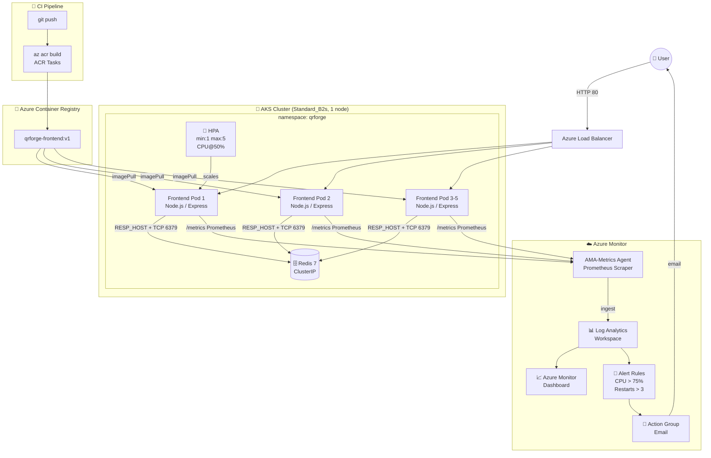

# QRForge 🔷
### A Production-Grade QR Code Generator — Cloud Lab Assignment

> **Stunning QR code generation** with 8 designer templates, Redis caching, Prometheus metrics,  
> Kubernetes HPA autoscaling, and full Azure Monitor observability.

---

## 📸 Screenshots

> _Replace these placeholders with your actual screenshots after completing the lab._

| Screenshot | Description |
|---|---|
| `[screenshot-ui.png]` | QRForge UI — template gallery and live preview |
| `[screenshot-acr-build.png]` | `az acr build` output in terminal |
| `[screenshot-hpa-scaling.png]` | `kubectl get hpa -w` during load test |
| `[screenshot-dashboard.png]` | Azure Monitor dashboard with 4 tiles |

---

## 🏗️ Architecture



---

## 📁 Project Structure

```
qrforge/
├── frontend/                    ← Node.js Express application
│   ├── server.js                ← Main server (QR gen, Redis cache, Prometheus)
│   ├── templates.json           ← 8 design template definitions
│   ├── package.json
│   ├── Dockerfile               ← Multi-stage Docker build
│   ├── .dockerignore
│   └── public/
│       ├── index.html           ← SPA with tabs, template gallery, preview
│       ├── style.css            ← Glassmorphism, dark/light theme, animations
│       └── app.js               ← Frontend logic: API calls, canvas, downloads
├── docker-compose.yml           ← Local development (frontend + redis)
├── k8s/
│   ├── namespace.yaml           ← namespace: qrforge
│   ├── redis-deployment.yaml
│   ├── redis-service.yaml       ← ClusterIP
│   ├── deployment.yaml          ← Frontend (cpu req: 100m, mem req: 128Mi)
│   ├── service.yaml             ← LoadBalancer port 80 → 3000
│   ├── hpa.yaml                 ← autoscaling/v2, min:1 max:5 CPU@50%
│   └── prometheus-configmap.yaml← AMA-Metrics scrape config
├── scripts/
│   ├── identity.sh              ← Student identity verification
│   ├── acr-build-push.sh        ← Build & push to ACR (bash)
│   ├── acr-build-push.ps1       ← Build & push to ACR (PowerShell)
│   └── aks-create.sh            ← Create AKS cluster
├── monitoring/
│   ├── enable-insights.sh       ← Container Insights + log restriction
│   ├── kql-queries.md           ← 6 ready-to-paste KQL queries
│   ├── dashboard.json           ← Azure Portal Dashboard template
│   └── alerts.sh                ← Action Group + 2 alert rules
├── loadtest/
│   ├── run-hey.sh               ← hey load generator (4 min, 50 workers)
│   ├── locustfile.py            ← Locust alternative
│   └── watch-commands.md        ← Terminal commands + screenshot checklist
├── docs/
│   └── REFLECTION_ANSWERS.md   ← Assignment questions a-e with guidance
└── README.md                    ← This file
```

---

## 🚀 Prerequisites

| Tool | Version | Install |
|---|---|---|
| Docker Desktop | 24+ | https://docker.com |
| Node.js | 20+ | https://nodejs.org (local dev only) |
| Azure CLI | 2.50+ | `winget install Microsoft.AzureCLI` |
| kubectl | 1.28+ | `az aks install-cli` |
| hey (load test) | any | https://github.com/rakyll/hey/releases |
| Locust (optional) | 2.x | `pip install locust` |

---

## 🔧 Local Development

### Run with Docker Compose (recommended)
```bash
# Clone / enter the repo
cd qrforge

# Build and start both services (frontend + redis)
docker compose up --build

# App is available at:
open http://localhost:3000
```

### Verify endpoints
```bash
# Health probes
curl http://localhost:3000/healthz
curl http://localhost:3000/readyz        # Returns 503 if Redis is down

# API
curl http://localhost:3000/api/templates
curl -X POST http://localhost:3000/api/qr \
  -H "Content-Type: application/json" \
  -d '{"type":"url","data":"https://example.com","template":"neon-cyber","size":512,"format":"png"}' \
  --output test.png

# Prometheus metrics
curl http://localhost:3000/metrics | grep qr_generated

# CPU-intensive endpoint
curl "http://localhost:3000/api/heavy?size=1024&n=5"
```

### Test readiness probe failure (Redis down)
```bash
docker compose stop redis
curl http://localhost:3000/readyz        # → 503 {"status":"not ready"}
docker compose start redis
curl http://localhost:3000/readyz        # → 200 {"status":"ready"}
```

---

## ☁️ Cloud Deployment — Exact Ordered Command Sequence

### Prerequisites
```bash
az login                    # Log in to Azure
az account show             # Verify correct subscription
```

### Step 1 — Identity verification (always run before screenshots)
```bash
bash scripts/identity.sh
```

### Step 2 — Build and push to ACR
```bash
# Bash (Linux/macOS/WSL):
bash scripts/acr-build-push.sh

# PowerShell (Windows):
.\scripts\acr-build-push.ps1

# Note the ACR_NAME printed at the end, e.g., qrforgeacrXXXXXX
export ACR_NAME="qrforgeacrXXXXXX"     # set to your actual name
export RESOURCE_GROUP="qrforge-rg"
```

### Step 3 — Create AKS cluster
```bash
ACR_NAME="${ACR_NAME}" RESOURCE_GROUP="${RESOURCE_GROUP}" \
  bash scripts/aks-create.sh

# Verify kubectl works
kubectl get nodes
```

### Step 4 — Update deployment image, apply k8s manifests
```bash
# Replace the ACR_NAME placeholder in deployment.yaml
sed -i "s/<ACR_NAME>/${ACR_NAME}/g" k8s/deployment.yaml    # Linux/macOS
# PowerShell:
(Get-Content k8s/deployment.yaml) -replace '<ACR_NAME>', $ACR_NAME | Set-Content k8s/deployment.yaml

# Apply all manifests in order
kubectl apply -f k8s/namespace.yaml
kubectl apply -f k8s/redis-deployment.yaml
kubectl apply -f k8s/redis-service.yaml
kubectl apply -f k8s/deployment.yaml
kubectl apply -f k8s/service.yaml
kubectl apply -f k8s/hpa.yaml
kubectl apply -f k8s/prometheus-configmap.yaml
```

### Step 5 — Wait for pods and get external IP
```bash
# Wait for all pods to be Running
kubectl get pods -n qrforge -w

# Get external IP (takes 60-90s to provision Azure Load Balancer)
kubectl get svc qrforge-frontend -n qrforge -w

# Export external IP
export EXTERNAL_IP=$(kubectl get svc qrforge-frontend -n qrforge \
  -o jsonpath='{.status.loadBalancer.ingress[0].ip}')
echo "App URL: http://${EXTERNAL_IP}"
```

### Step 6 — Enable Container Insights monitoring
```bash
RESOURCE_GROUP="${RESOURCE_GROUP}" CLUSTER_NAME="qrforge-aks" \
  bash monitoring/enable-insights.sh
```

### Step 7 — Create alerts
```bash
# Edit ALERT_EMAIL first
ALERT_EMAIL="your@email.com" \
  RESOURCE_GROUP="${RESOURCE_GROUP}" \
  CLUSTER_NAME="qrforge-aks" \
  bash monitoring/alerts.sh
```

### Step 8 — Import dashboard (Portal)
1. Azure Portal → search **Dashboard** → **+ New dashboard** → **Upload**
2. Upload `monitoring/dashboard.json`
3. Edit each tile to scope it to your cluster/workspace
4. Pin queries from `monitoring/kql-queries.md`

### Step 9 — Load test
```bash
# Open 4 terminals with the watch commands from loadtest/watch-commands.md
# Then in the main terminal:
EXTERNAL_IP="${EXTERNAL_IP}" bash loadtest/run-hey.sh

# OR using Locust:
locust -f loadtest/locustfile.py \
  --host="http://${EXTERNAL_IP}" \
  --users=50 --spawn-rate=5 --run-time=5m --headless
```

---

## 🧹 Cleanup — DELETE ALL RESOURCES (after screenshots)

> ⚠️ **Do this immediately after taking all screenshots to avoid charges!**

```bash
# Delete ALL resource groups created by this lab:
az group delete --name qrforge-rg --yes --no-wait

# Also delete the auto-created node resource group:
# It is named MC_<rg>_<cluster>_<location>, e.g.:
az group delete --name MC_qrforge-rg_qrforge-aks_eastus --yes --no-wait

# Delete the default Log Analytics resource group (if created separately):
az group delete --name DefaultResourceGroup-EUS --yes --no-wait 2>/dev/null || true

# Verify nothing remains (check billing):
az group list --output table
```

**Full cleanup PowerShell:**
```powershell
az group delete --name qrforge-rg --yes --no-wait
# List remaining groups to find MC_* group:
az group list --query "[?starts_with(name,'MC_')]" --output table
```

---

## 🔍 Troubleshooting

| Problem | Diagnosis | Fix |
|---|---|---|
| `readyz` returns 503 | Redis not connected | Check `kubectl get pods -n qrforge`, Redis pod might be CrashLoopBackOff |
| HPA shows `<unknown>` CPU | metrics-server missing | `kubectl apply -f https://github.com/kubernetes-sigs/metrics-server/releases/latest/download/components.yaml` |
| Image pull error | ACR not attached to AKS | `az aks update -g qrforge-rg -n qrforge-aks --attach-acr <acr-name>` |
| HPA `FailedGetResourceMetric` | `resources.requests.cpu` missing | Restore `cpu: 100m` in deployment.yaml and re-apply |
| Load test no scaling | CPU too low | Increase `n` and `size`: `/api/heavy?size=2000&n=20` |
| Pods OOMKilled | Memory limit too low | Increase `limits.memory` to `512Mi` in deployment.yaml |
