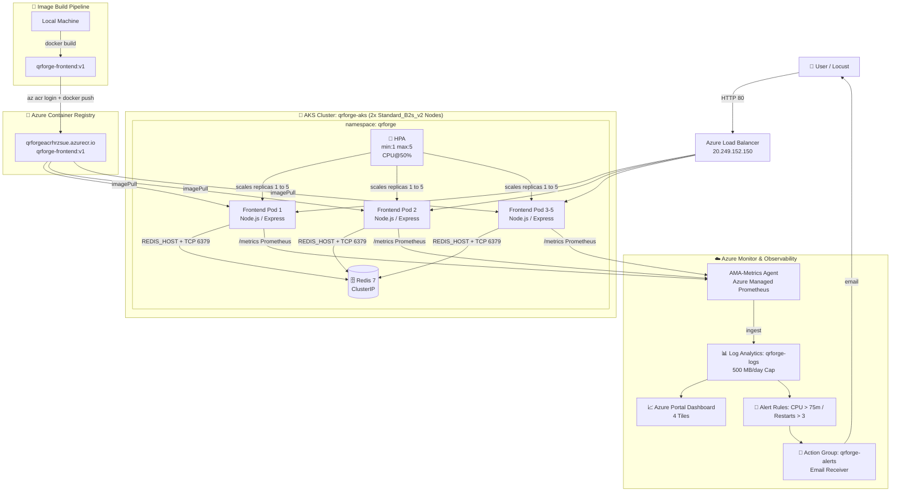

# QRForge 🔷
### A Production-Grade QR Code Generator — Cloud Lab Assignment

> **Stunning QR code generation** with 8 designer templates, Redis caching, Prometheus metrics,  
> Kubernetes HPA autoscaling, and full Azure Monitor observability.

---

## 📸 Screenshots & Evidence

Screenshots and reflection answers are provided in the separate project PDF.

---

## ⚠️ Deviations from the Brief

During lab execution, specific constraints and findings required five necessary operational adjustments:

1. **VM SKU Restricted (`Standard_B2s` → `Standard_B2s_v2` in `koreacentral`):**
   `Standard_B2s` was restricted (`NotAvailableForSubscription`) across all subscription-allowed regions (`uaenorth`, `eastasia`, `polandcentral`, `koreacentral`, `malaysiawest`). Based on real `az vm list-skus` validation, `Standard_B2s_v2` (2 vCPUs, 4 GiB RAM, unrestricted) in `koreacentral` was selected and deployed.
2. **ACR Tasks Disabled (`az acr build` → Local Docker Build & Push):**
   `az acr build` failed with `TasksOperationsNotAllowed` (ACR Tasks disabled on student subscription). As approved, the image was built locally with Docker Desktop (`docker build -t qrforge-frontend:v1 .\frontend`) and pushed directly via `az acr login` and `docker push qrforgeacrhrzsue.azurecr.io/qrforge-frontend:v1`.
3. **Node Pool Scaling (1 Node → 2 Nodes):**
   AKS Container Insights and Azure Managed Prometheus system pods (`ama-logs`, `ama-metrics`, `metrics-server`, `azure-cns`) consumed over 633m of node allocatable CPU. With only 1 node, a 5-replica frontend scale-out plus Redis could not be scheduled. The node pool was scaled to 2 nodes (`Standard_B2s_v2`, 4 total vCPUs, within regional quota), eliminating all pod pending bottlenecks.
4. **Reflection Q4 Missing-Requests Demo on Throwaway Deployment:**
   To capture real Kubernetes error messages without breaking the production application, a temporary deployment `qrforge-noreq` and HPA `qrforge-noreq-hpa` were created without requests or limits. Real output was recorded (`missing request for cpu...`, `ScalingActive: False`), after which both resources were deleted.
5. **Run 1 Memory Exhaustion & Run 2 Calibration:**
   The initial load test (`size=2000&n=10`, 50 users) allocated ~16 MB uncompressed memory per QR canvas, quickly exceeding the container's 256Mi memory limit and causing `OOMKilled` crashes (exit code 137). To evaluate clean HPA scaling, a calibrated second test (Run 2: 20 users, `size=1024&n=3`) was conducted, successfully scaling replicas 1 → 3 → 4 → 5 without memory crashes.

---

## 🏗️ Architecture



---

## 📁 Project Structure

```
qrforge/
├── frontend/                    ← Node.js Express application
│   ├── server.js                ← Main server (QR gen, Redis cache, Prometheus)
│   ├── templates.json           ← 8 design template definitions
│   ├── package.json
│   ├── Dockerfile               ← Multi-stage Docker build (229 MB final image)
│   ├── .dockerignore
│   └── public/
│       ├── index.html           ← SPA with template gallery, preview
│       ├── style.css            ← Modern glassmorphism UI
│       └── app.js               ← Frontend logic & canvas generation
├── docker-compose.yml           ← Local development (frontend + redis)
├── k8s/
│   ├── namespace.yaml           ← namespace: qrforge
│   ├── redis-deployment.yaml
│   ├── redis-service.yaml       ← ClusterIP
│   ├── deployment.yaml          ← Frontend (cpu req: 100m, limit: 200m)
│   ├── service.yaml             ← LoadBalancer port 80 → 3000
│   └── hpa.yaml                 ← autoscaling/v2, min:1 max:5 CPU@50%
├── scripts/
│   ├── identity.ps1             ← Student identity verification
│   ├── acr-build-push.ps1       ← Build & push to ACR fallback
│   └── aks-create.ps1           ← AKS cluster creation
├── monitoring/
│   ├── container-azm-ms-agentconfig.yaml ← Log restriction ConfigMap (500 MB/day safety)
│   ├── kql-queries.md           ← Ready-to-use KQL monitoring queries
│   ├── dashboard.json           ← Azure Portal Dashboard template
│   └── alerts.sh                ← Alert rules (Max CPU > 75m, Restarts > 3)
├── loadtest/
│   ├── locust-gentle.py         ← Calibrated load profile (20 users, 1024x1024)
│   ├── locust-heavy.py          ← Heavy load profile (50 users, 2000x2000)
│   ├── collect-evidence.ps1     ← JSON-parsed timeline logger
│   └── results/                 ← Locust HTML reports, CSV stats & timeline logs
└── README.md                    ← This file
```

---

## 🔍 Troubleshooting Reference

| Issue Observed | Root Cause | Verified Resolution |
|---|---|---|
| `TasksOperationsNotAllowed` | ACR Tasks disabled on student subscription | Local `docker build` + `docker push` with `az acr login` |
| `Standard_B2s` Restricted | Regional quota/policy restriction | Deployed `Standard_B2s_v2` in `koreacentral` |
| Frontend pods `Pending` | 1-node CPU exhausted by monitoring pods | Scaled nodepool to 2 nodes (`nodepool1`, 2 nodes) |
| Pods `OOMKilled` (Exit 137) | Heavy QR canvas memory allocation exceeding 256Mi | Calibrated load test to `size=1024&n=3` |
| HPA `<unknown>` Metric | Container missing `resources.requests` | Retained `cpu: 100m` in `k8s/deployment.yaml` |
